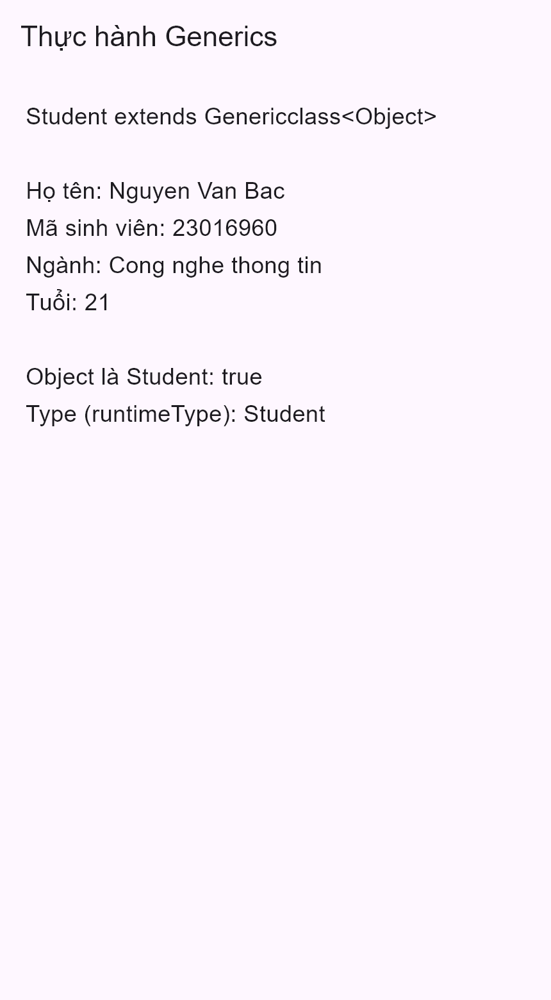

# Ứng dụng quản lý sinh viên

Ứng dụng Flutter/Dart.

## Bài tập Generics

- Theo [tài liệu của giảng viên](https://nglthu.github.io/flutter_docs/docs/generic_class).
- Lớp dùng chung [Genericclass<T>](lib/models/generic_class.dart) có `id`, `name`, `description`, constructor và các hàm get/set.
- Lớp có sẵn [Student](lib/models/student.dart) kế thừa `Genericclass<Object>`: `id` là mã sinh viên, `name` là họ tên, `description` là ngành học. `age` là thuộc tính riêng của sinh viên.
- [GenericsScreen](lib/screens/generics_screen.dart) minh họa gán `Student` cho biến `Object`, lấy `Type` bằng `runtimeType`, hiển thị thông tin sinh viên.

Trong Dart, `runtimeType` trả về `Type` để xem thông tin lớp; Dart không có lớp tên `Class` như Java.
Tài liệu: [Generics](https://dart.dev/language/generics), [Object.runtimeType](https://api.dart.dev/dart-core/Object/runtimeType.html).

## Chạy bài

```sh
flutter pub get
flutter run
```

Tại Home, chọn **Thực hành Generics**.

## Nội dung nộp

- Code chính: ba file được liên kết ở trên.
- README: [README trên GitHub](https://github.com/QLSV-Bac-Khoi-Hiep-Phat-N05-1-2026/appQuanLySInhVien/blob/main/README.md).
- Ảnh minh họa màn hình Flutter (xuất bằng widget test): [generics.png](docs/screenshots/generics.png).
- Commit: xem commit **Hoàn thành bài tập Generics** trong [lịch sử commit](https://github.com/QLSV-Bac-Khoi-Hiep-Phat-N05-1-2026/appQuanLySInhVien/commits/main/).



## Bài tập lớn cuối kỳ

- [16 user stories và nghiệm thu](docs/01-user-stories.md).
- [Model, Firestore, API và hướng dẫn thiết lập](docs/02-data-and-firebase.md).
- [Trạng thái kiểm chứng](docs/03-verification.md).

Phần nền dữ liệu đã chuẩn bị; giao diện nghiệp vụ của 16 stories còn trong backlog.

- [Hướng dẫn nhận việc cho Bắc, Phát, Khôi, Hiệp](docs/04-team-handoff.md).
- [Bằng chứng kiểm tra Firebase cloud](docs/05-g1-cloud-evidence.json).
