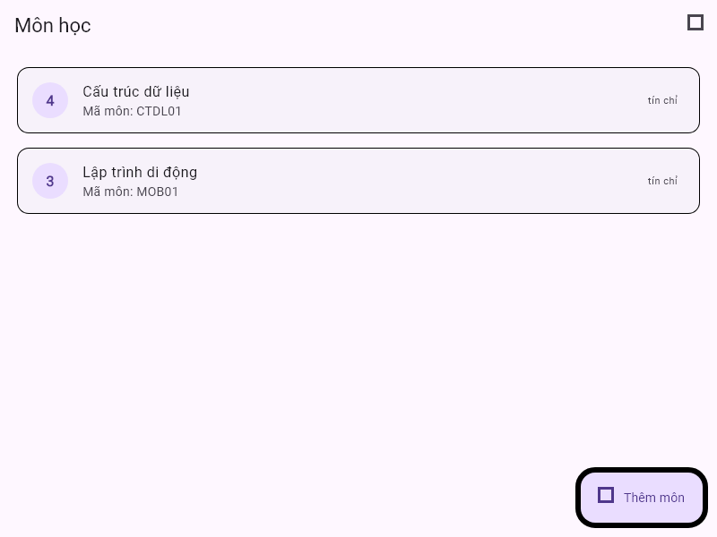

# Báo cáo GĐ1 — G1-05

Ngày thực hiện: 27/10/2026 (giờ Việt Nam). G1-05 là mã nhiệm vụ trong GĐ1. Phụ trách: Nguyễn Huy Hiệp.

## Kiểm tra thực tế

| Hạng mục | Kết quả |
|---|---|
| Flutter / Dart | PASS — Flutter 3.47.8, Dart 3.13.7 |
| flutter analyze | PASS — No issues found |
| flutter test | PASS — 21 tests |
| Java / Firestore Rules Emulator | PASS — Temurin Java 21.0.12.1; 6 tests, project giả demo-qlsv, cổng chuẩn 18080 |
| Phạm vi môi trường | Emulator/local tests; không đọc/ghi Firebase cloud trong lần chạy này |
| npm ci | PASS — cài dependency theo package-lock; npm báo 11 advisory trong dev dependency tree (6 moderate, 5 high) |

Các lần đầu dùng Java 26.0.1 làm Firestore Emulator thoát mã 3221225786. Đã tải Temurin JDK 21 portable, kiểm tra SHA-256 theo metadata Adoptium và chỉ đặt JAVA_HOME/PATH cho tiến trình test; sau đó rules suite chạy đạt trên cổng chuẩn 18080. Không thay đổi cài đặt Java hệ thống. Rules test chạy trên project giả, không tác động cloud.

## Rà PR #1

PR #1 — “G1: Hoàn thiện nền Firebase và bàn giao cho nhóm” — đã đóng và merge lúc 09:53:22 ngày 27/10/2026 (giờ Việt Nam), head commit b098fd5a1d650bcb6a750e8eed78b775fd5a2d17. Hai GitHub checks trên head đều success: [Flutter analyze and tests](https://github.com/QLSV-Bac-Khoi-Hiep-Phat-N05-1-2026/appQuanLySInhVien/actions/runs/40440746590/job/121980233568) và [Firestore rules emulator](https://github.com/QLSV-Bac-Khoi-Hiep-Phat-N05-1-2026/appQuanLySInhVien/actions/runs/40440746590/job/121980233263). GitHub API hiện không trả review event hoặc issue comment nào cho PR; vì PR đã merge, kết quả dưới đây là rà soát hồi cứu, không được ghi thành GitHub approval của Hiệp.

- Finding P2 — định dạng học kỳ: Grade chỉ kiểm tra semester theo mẫu mã chung 1–80 ký tự; Firestore Rules cũng chỉ gọi code(semester). Như vậy các kỳ như 2026-3 hoặc ABC vẫn được model/rules chấp nhận, trong khi contract quy định 2026-1 và 2026-2. Cần siết validator ở model và Rules, rồi thêm test đúng/sai trong US15. Đây là lỗi contract cho luồng nhập điểm, không làm hỏng các test nền hiện tại.
- Không thấy finding chặn ở quyền manager hoặc luồng tạo/đọc dữ liệu trong phạm vi test nền; quyền delete vẫn đóng như thiết kế.

## Ảnh minh chứng

Ảnh golden của màn hình danh sách môn học, dùng dữ liệu mẫu và font Roboto:

Ma trận 16 stories và fixture mẫu vẫn ở docs/07-test-matrix.md. Phần kiểm chứng lịch sử và kết quả chạy mới được cập nhật ở docs/03-verification.md.

